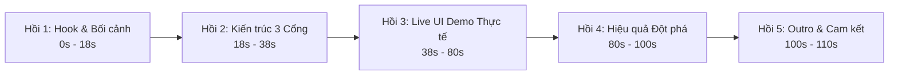

# MASTER PROMPT: TẠO VIDEO HOÀN CHỈNH GIỚI THIỆU & DEMO GIẢI PHÁP QUẢN LÝ VẬT LIỆU NỔ CÔNG NGHIỆP (VLNCN)

> **Tài liệu nguồn cơ sở:** [QLVLNCN_08102026.pdf](/QLVLNCN_08102026.pdf)  
> **Địa chỉ hệ thống phần mềm Demo:** [http://dev-qn-mm.evotek.vn/login](http://dev-qn-mm.evotek.vn/login)  
> **Hệ sinh thái Motion Skills có sẵn trong repo:** `.agents/skills/` (Remotion, Demo, Explainer, Infographic, Map, Audio, Typography, Specs...)

---

## 1. MỤC TIÊU ĐẦU RA (PRIMARY DELIVERABLE)

**Đầu ra bắt buộc là THÀNH PHẨM VIDEO HOÀN CHỈNH (file `output/video-gioi-thieu-vlncn.mp4`)**, KHÔNG CHỈ DỪNG LẠI Ở KỊCH BẢN CHỮ.

Toàn bộ quy trình từ dựng hình, chuyển động, quay màn hình demo, lồng tiếng, âm thanh đến xuất file MP4 phải được phối hợp và thực thi tự động thông qua **hệ thống kỹ năng video chuyên sâu có sẵn trong repository**.

---

## 2. MA TRẬN KỸ NĂNG VIDEO ÁP DỤNG (VIDEO SKILLS INTEGRATION MATRIX)

Để đạt chất lượng video chuẩn phát sóng truyền hình / hội nghị công nghệ cao cấp, dự án bắt buộc áp dụng đồng bộ các kỹ năng sau:

| Nhóm kỹ năng | Skill trong repo | Nhiệm vụ cụ thể trong video |
|---|---|---|
| **Lõi Dựng & Render** | `remotion-video` | Lập trình timeline bằng React, quản lý Sequence/Series, frame-driven animation (`useCurrentFrame`, `interpolate`, `spring`), xuất file MP4 qua CLI. |
| **Tiêu chuẩn Chuyển động** | `animation-principles` `60fps-animation` | Thiết lập easing curve tự nhiên (mass, damping, stiffness), tránh giật lag, đảm bảo khung hình chuyển động 60fps siêu mượt. |
| **Chỉ đạo Nghệ thuật** | `motion-art-direction` `shot-composition` | Định hình phong cách thị giác GovTech hiện đại, bố cục 16:9 chuẩn an toàn hiển thị (title-safe areas), phân cấp thị giác rõ ràng. |
| **Nền & Hiệu ứng Đồ họa** | `motion-background` `glassmorphism` | Nền lưới công nghệ chuyển động nhẹ nhàng; các thẻ thông số HUD và card UI bán trong suốt viền phát sáng sang trọng. |
| **Nhận diện & Thuyết minh** | `logo-animation` `lower-thirds-video` | Intro animation logo Bộ Công an & PC06; thanh Lower Third chuẩn truyền hình hiển thị tên, cấp bậc cán bộ thuyết minh. |
| **Địa bàn & Bối cảnh** | `map-animation` | Bản đồ số tỉnh Quảng Ninh định vị 58 kho mỏ và tuyến đường vận chuyển VLNCN với hiệu ứng quét radar. |
| **Số liệu & Quy trình** | `animated-infographic` `diagram-animation` `chart-animation` | Sơ đồ động 3 Cổng kết nối CSDL trung tâm; quy trình khép kín 8 bước; count-up ticker các chỉ số (58 kho, từ 2 ngày $\rightarrow$ tức thì). |
| **Trình diễn Phần mềm** | `product-demo-video` | Tích hợp browser subagent ghi hình thật tại demo, gắn browser frame, animated cursor, hiệu ứng click ripple và zoom-in callout các nút bấm. |
| **Chữ Động & Phụ đề** | `kinetic-typography` `caption-animation` | Giật chữ nổi bật từ khóa thông điệp ("CHUYỂN ĐỔI SỐ", "CẶP LIÊN THÔNG"); phụ đề karaoke đồng bộ từng từ theo giọng đọc. |
| **Âm thanh & Nhịp điệu** | `soundtrack` `beat-sync-editing` | Nhạc nền công nghệ hào hùng, thiết kế hiệu ứng âm thanh (whoosh, click, digital chime), audio ducking tự động khi có giọng đọc VO. |
| **Đóng gói & Xuất bản** | `youtube-intro-outro` `video-delivery-specs` | Card kết thúc chuẩn nhận diện; xuất file MP4 chuẩn H.264/AAC, kiểm tra chất lượng stills với script có sẵn (`contact-sheet.sh`). |

---

## 3. HÌNH TƯỢNG NGƯỜI DẪN & TONE CHỦ ĐẠO (PERSONA)

- **Người dẫn chuyện:** Cán bộ Công an nhân dân thuộc **Phòng Cảnh sát QLHC về TTXH (PC06) - Công an TP Quảng Ninh**.
- **Phong thái:** Trang nghiêm, dứt khoát, chuẩn mực nghiệp vụ CAND, tự tin làm chủ công nghệ theo tinh thần Đề án 06/CP.
- **Tone giọng:** Trầm ấm, hào hùng, đanh thép, giàu sức thuyết phục (chuẩn phát thanh viên truyền hình CAND).
- **Màu sắc thương hiệu:** Xanh sẫm Công an (`#0B2545`), Xanh công nghệ hiện đại (`#0077B6`, `#00B4D8`), Vàng nhận diện CAND (`#FFB703`).

---

## 4. DỮ LIỆU ĐĂNG NHẬP HỆ THỐNG DEMO ĐỂ THU THẬP FOOTAGE

Hệ thống demo trực tuyến: **`http://dev-qn-mm.evotek.vn/login`**

### A. Tài khoản Quản trị Hệ thống (Admin)
- **Tài khoản:** `admin@vlncn.com` | **Mật khẩu:** `Admin@123`
- **Màn hình quay thực tế:**
  1. Danh sách 58 kho VLNCN và cấu hình sức chứa thiết kế (tấn/kg).
  2. Danh mục chuẩn hóa chủng loại VLNCN 2 tầng.
  3. Quản lý biểu mẫu in toàn thành phố & Nhật ký bất biến (Audit Logs) không thể can thiệp.

### B. Tài khoản Cổng Công an (PC06)
- **Tài khoản:** `ca@vlncn.com` | **Mật khẩu:** `Admin@123`
- **Màn hình quay thực tế:**
  1. **Dashboard Tổng quan:** Bản đồ chỉ số toàn thành phố, cảnh báo kho vượt ngưỡng an toàn, giấy phép sắp hết hạn.
  2. **Xử lý Cặp liên thông:** Thao tác đối soát tự động 2 cột bên Mua & bên Bán, bấm nút "Phê duyệt & Cấp số điện tử".
  3. **Tra cứu & Hậu kiểm:** Quét mã QR xem toàn bộ timeline vòng đời (thủ kho, lái xe, áp tải), theo dõi lộ trình xe trên bản đồ số GPS.

---

## 5. KỊCH BẢN PHÂN CẢNH VÀ PHỐI HỢP SKILL (TIMELINE & SKILL MAPPING)

Thời lượng chuẩn: **90 – 120 giây** | Tỷ lệ: **16:9 (1920x1080, 60fps)**

### Phân cảnh 1: Mở đầu & Thách thức quản lý (0s – 18s)
- **Nội dung:** Quảng Ninh - trung tâm than khoáng sản, 58 kho VLNCN. Khối lượng lưu chuyển khổng lồ. Bất cập của quản lý giấy thủ công.
- **Skills áp dụng:**
  - `logo-animation`: Logo Công an TP Quảng Ninh & Bộ Công an xuất hiện trang trọng.
  - `map-animation`: Bản đồ số tỉnh Quảng Ninh định vị 58 kho phát sáng đỏ.
  - `kinetic-typography`: Con số "58 KHO HOẠT ĐỘNG" nảy bật mạnh mẽ.
  - `lower-thirds-video`: Hiện bảng tên cán bộ PC06 thuyết minh.
  - `soundtrack` & `beat-sync-editing`: Nhạc nền cinematic bắt đầu nhịp trống dồn dập.

### Phân cảnh 2: Giải pháp & Kiến trúc 3 Cổng (18s – 38s)
- **Nội dung:** Giới thiệu Hệ thống Quản lý VLNCN dùng chung 1 CSDL tập trung toàn thành phố.
- **Skills áp dụng:**
  - `diagram-animation`: Sơ đồ động 3 Cổng (Cổng PC06, Cổng Doanh nghiệp, Cổng Quản trị) kết nối đồng bộ vào một lõi CSDL phát sáng với biểu tượng lá chắn bảo mật.
  - `glassmorphism`: 3 card thể hiện vai trò của 3 cổng với viền sáng neon tinh tế.
  - `animation-principles`: Hiệu ứng spring entrance mượt mà cho các khối chức năng.

### Phân cảnh 3: Trải nghiệm UI Demo Thực tế (38s – 80s)
- **Nội dung:** Trình diễn trực tiếp trên giao diện phần mềm `dev-qn-mm.evotek.vn`:
  1. *Dashboard PC06:* Cảnh báo trực quan thời gian thực.
  2. *Cặp liên thông:* Đối soát tự động đơn Mua - Bán, duyệt và cấp số điện tử 1 chạm.
  3. *Truy vết QR & Giám sát GPS:* Quét mã QR xem lịch sử, kiểm tra hành trình xe chuyên dụng.
  4. *Quản lý kho & Cơ chế Offline:* Giám sát % sức chứa, giải pháp in phiếu QR cho hầm lò cấm sóng.
- **Skills áp dụng:**
  - `product-demo-video`: Khung trình duyệt macOS/Windows sang trọng bọc quanh giao diện web thật, con trỏ chuột di chuyển mượt mà kèm click ripple.
  - `shot-composition`: Pan & Zoom mượt mà vào khu vực nút bấm duyệt và bản đồ GPS.
  - `caption-animation`: Phụ đề highlight từng từ giải thích thao tác nghiệp vụ.

### Phân cảnh 4: Hiệu quả Toàn diện & Lợi ích 3 Bên (80s – 100s)
- **Nội dung:** Chuyển đổi từ "bị động chờ báo cáo" sang "chủ động giám sát trên dữ liệu". Lợi ích cho Lãnh đạo, Cán bộ PC06, và Doanh nghiệp.
- **Skills áp dụng:**
  - `animated-infographic` & `chart-animation`: So sánh trực quan Before/After (thời gian xác nhận từ 2 ngày $\rightarrow$ tức thì; giảm 80% thời gian xử lý thủ công).
  - `kinetic-typography`: Bật sáng các từ khóa giá trị cốt lõi: *"CHÍNH XÁC - MINH BẠCH - AN TOÀN - TIẾT KIỆM"*.

### Phân cảnh 5: Lời kết & Cam kết An ninh số (100s – 110s)
- **Nội dung:** Thông điệp bảo đảm an ninh trật tự, phục vụ phát triển kinh tế xã hội.
- **Skills áp dụng:**
  - `youtube-intro-outro`: End-card nhận diện chính quy, biểu tượng lá chắn CAND, thông tin liên hệ.
  - `soundtrack`: Nhạc nền chuyển sang hợp âm kết thúc hào hùng, lan tỏa.

---

## 6. QUY TRÌNH THỰC THI TỰ ĐỘNG HÓA (STEP-BY-STEP EXECUTION PIPELINE)

Để sản xuất ra file video, AI/Agent sẽ tự động triển khai theo 5 bước:

1. **Bước 1 - Ghi hình giao diện thực tế (Footage Capture):**
   - Sử dụng `browser_subagent` hoặc script tự động đăng nhập vào `http://dev-qn-mm.evotek.vn/login` với cả 2 tài khoản `admin@vlncn.com` và `ca@vlncn.com`.
   - Xuất các file ảnh chụp / video clip chất lượng cao (1080p) tại các màn hình trọng yếu.
2. **Bước 2 - Chuẩn bị Audio & Lời dẫn (Voiceover & Soundtrack):**
   - Biên soạn kịch bản lời thoại chuẩn phong cách cán bộ Công an theo từng timecode.
   - Sử dụng công cụ tổng hợp âm thanh tạo file giọng đọc tiếng Việt (`vo.mp3`/`vo.wav`).
   - Tích hợp track nhạc nền cinematic và bộ hiệu ứng SFX qua kỹ năng `soundtrack`.
3. **Bước 3 - Xây dựng Remotion Project (`remotion-video`):**
   - Khởi tạo composition Remotion `1920x1080` @ 60fps.
   - Ghép nối các Sequence theo kịch bản: Intro, 3-Cổng Diagram, Screen Walkthrough, Infographic, Outro.
   - Thêm animated cursor, callouts, kinetic typography và phụ đề chạy chữ karaoke.
4. **Bước 4 - Kiểm tra Chất lượng (Verification Pass):**
   - Render các frame tĩnh kiểm tra bố cục bằng lệnh: `npx remotion still ...` theo hướng dẫn kỹ năng `video-delivery-specs`.
   - Dùng script `scripts/contact-sheet.sh` để kiểm tra độ chính xác của hình ảnh trước khi render toàn bộ.
5. **Bước 5 - Xuất bản Video Hoàn chỉnh (Final Render):**
   - Chạy lệnh render xuất file: `npx remotion render VideoGioiThieu output/video-gioi-thieu-vlncn.mp4`.
   - Dùng `scripts/probe-mp4.sh` hoặc `ffmpeg` để kiểm tra thông số kỹ thuật (độ phân giải 1080p, bitrate, âm thanh đồng bộ).
